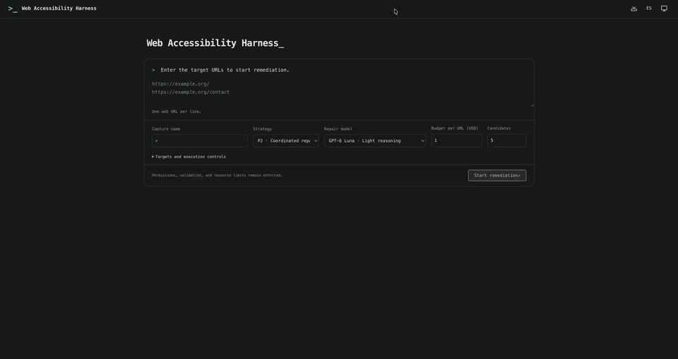

# Harness Engineering for Web Accessibility: Orchestrating Automated Remediation with Agents and LLMs

<a href="https://www.youtube.com/watch?v=wtjlfBK9N7M">
  
</a>

This repository accompanies the research article Harness Engineering for Web
Accessibility: Orchestrating Automated Remediation with Agents and LLMs. It
provides the Web Accessibility Harness research implementation and the evidence
for its four experimental comparisons.

Harness engineering places explicit execution contracts around language models:
models propose interventions, while deterministic software governs source
admission, permitted edits, measurement, resource reservations, continuation and
result selection. The research examines how these controls support repeatability
and make the trade-offs between accessibility correction, content preservation
and resource use inspectable.

## Installation

Requirements: Git, Docker with Docker Compose, and a browser. Cloud model calls
require an enabled provider account. Reading the exported experiment evidence
requires neither a provider account nor a running application.

```bash
git clone https://github.com/gverafei/web-accessibility-harness.git
cd web-accessibility-harness
cp .env.example .env
```

Edit `.env` before startup. Set a private `SECRET_KEY`, distinct MySQL user/root
passwords, and matching `DB_PASSWORD` / `MYSQL_PASSWORD`. Configure
`OPENROUTER_API_KEY` here or later through the application's Configuration screen.
Keep `.env` outside version control.

```bash
docker compose up --build -d
```

Open **http://localhost:80**. Change `WEB_HOST_PORT` in `.env` if that port is
already in use. Compose groups all services under `web-accessibility-harness`.
Only the web service is exposed, on loopback; MySQL, Qdrant, the evaluator and
saved-page server remain internal.

## Running remediation

1. Open **Configuration** and configure the provider connection. In **Models**,
   review and enable a repair model, the Decisions model and the supported visual
   verification configuration. Provider availability and prices can change;
   stored metadata does not guarantee continued access to a historical model.
2. Enable the background worker explicitly:

   ```bash
   docker compose --profile worker up --build -d
   ```

3. Initialize a frozen ACT corpus through **RAG-ACT**. The selected corpus is
   part of the execution configuration; **Use RAG-ACT** controls whether retrieved
   examples are supplied to the repair model.
4. In **Start**, enter one public web URL per line. Optionally name the capture,
   select P0–P5, and review the repair model, audit targets, time, iteration and
   budget limits. The form defaults to **P2** and **US$1 per URL**.
5. Select **Start remediation**. A loading button immediately opens the
   remediation screen, showing capture and baseline activity until the execution
   diagram is ready. Multiple URLs open the corresponding execution list. **Captures**
   retains the original measurements; **Executions** shows proposals, selected
   outputs and the recorded stopping reason; **Activity** summarizes resources.
   Batch listings identify failed captures and link to their capture report.

The candidate limit counts changed pages that reach evaluation. Proposals rejected
before evaluation, empty proposals and unchanged outputs do not consume slots.
**Attempts per candidate** defaults to 20 generation attempts and resets after
each evaluated page. Time and monetary limits can stop execution sooner.
New runs finish generation at Axe WCAG 0 and Lighthouse 100,
then complete the final taxonomy assessment. These audit scores do not imply
complete accessibility; complementary findings remain in the report.
**Stop** finishes the current candidate, preserves recorded results and charges,
and prevents another generation. With multiple URLs, the preparation view opens
the Executions list filtered to those submissions, each with its own URL budget.

`Ctrl+K` / `Cmd+K` opens command navigation. The header navigation button or
`Ctrl+Shift+M` / `Cmd+Shift+M` hides or shows the floating menu.

The worker is opt-in, and requests execute only after task submission. Model
calls may incur provider charges within the configured limits. The supplied
application is intended for local research use; its loopback binding should be
preserved. Experimental results are available as files and are not imported into
a fresh installation automatically.

```bash
# Inspect startup or execution diagnostics.
docker compose logs --tail=100 web worker evaluator

# Stop without deleting persistent data.
docker compose --profile worker stop
```

MySQL and Qdrant use named volumes. Local `data/`, `results/` and `datasets/`
directories hold captured evidence and generated outputs. Preserve both the
volumes and these directories when keeping an installation's results.

## Experimental evidence

[experiments/TWEB](experiments/TWEB/README.md) contains one evidence folder per
experiment. CSV and JSON files link sources, runs, evaluated versions,
measurements, selected results, prompts, skills, decisions and resource records.
Each folder includes checksums, compact snapshot thumbnails, the reader-facing
supplementary PDF, its LaTeX source and a Python regeneration script. The
shared `plots/` folder collects the numbered paper graphs, with Python generators
that use the same exported CSV evidence.

| Experiment | Frozen sources | Runs | Evaluated versions |
| --- | ---: | ---: | ---: |
| 1. Harness determinism, P1–P2 | 5 | 30 | 116 |
| 2. Fixed interventions, P0–P4 | 30 | 450 | 1,074 |
| 3. Model family and reasoning effort, P4 | 1 | 12 | 20 |
| 4. Page-guided adaptive selection, P5 | 30 | 30 | 128 |
| **Total (35 unique sources)** | **35** | **522** | **1,338** |

Sources overlap across experiments. Evaluated versions are the measured
candidates within runs, rather than the number of independent sources. Selected
outputs and visual acceptance are distinct; automated measurements do not establish
WCAG conformance. See each experiment's README for units, inclusion rules and
accounting scope.

Verify the files offline without a database or model calls:

```bash
python3 experiments/TWEB/verify.py
```

Rebuilding a supplementary PDF also requires Python 3.10 or later with `pypdf` and a LaTeX
distribution containing `latexmk` and the ACM fonts:

```bash
python3 -m pip install -r experiments/TWEB/requirements.txt
python3 experiments/TWEB/experiment-1/generate.py
```

Regenerate all eleven numerical paper figures from those same packages:

```bash
python3 experiments/TWEB/plot_all.py
python3 experiments/TWEB/verify.py
```

All paper graphs are collected in [experiments/TWEB/plots](experiments/TWEB/plots/README.md),
with numbered filenames and an index linking them to each experiment. Snapshot
miniatures remain in each experiment’s `thumbnails/` folder. Shared plotting
functions are in `experiments/TWEB/plotting/`. Input and code hashes, plotted
summaries and figure resolution are recorded beside the graphs.

The included ACM class is used for the reports. Ordinary compilation preserves
the editable `main.tex`; `--refresh-source` explicitly regenerates it from the
exported evidence. Neither operation launches experiments or contacts providers.

## Repository Layout

| Path | Contents |
| --- | --- |
| `web/app/` | Flask application, deterministic controller, intervention contracts, model interfaces, task skills, reports and shared interface components |
| `web/tests/` | Isolated Python and JavaScript checks for contracts, accounting, evidence boundaries, navigation and reporting |
| `evaluator/` | Node.js/Chromium capture, frozen replay, Axe, Lighthouse, HTML validation and browser regression fixtures |
| `dataset_server/` | Internal server for saved page resources |
| `db/`, `qdrant/` | Database and retrieval service images used by Compose |
| `experiments/TWEB/` | Four experiment evidence packages, supplementary reports, paper figures, Python generators and offline verification |
| `.env.example`, `docker-compose.yml` | Example configuration and the complete local service group |
| `LICENSE` | MIT license |

## Software verification

The web checks use mocked services and temporary evidence stores. Run them in a
disposable container with networking disabled, empty provider credentials and
read-only source:

```bash
docker compose build web
docker run --rm --network none \
  -v "$PWD/web/app/translations:/translations" \
  web-accessibility-harness-web pybabel compile -d /translations
docker run --rm --network none --read-only \
  --tmpfs /tmp --tmpfs /data --tmpfs /results \
  -e HARNESS_TESTING=1 -e OPENROUTER_API_KEY= -e OPENAI_API_KEY= \
  -e PYTHONDONTWRITEBYTECODE=1 -e PYTHONPATH=/workspace/web/app \
  -v "$PWD:/workspace:ro" -w /workspace \
  web-accessibility-harness-web \
  python -m unittest discover -s web/tests -q
```

See [evaluator/README.md](evaluator/README.md) for offline browser checks. Software
fixtures are separate from the scientific observations in `experiments/TWEB`.

## License and citation

The implementation is distributed under [MIT](LICENSE). Third-party page captures
and resources retain their respective rights and are not relicensed by the
software license. The experimental packages contain reduced thumbnails rather
than complete captured websites.

If you use this research in academic work, please cite the accompanying paper
once it is available. For now, referencing this repository is sufficient.
